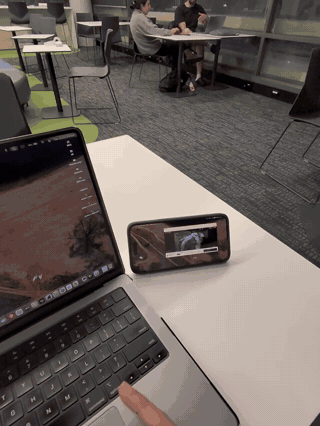

# iPhone Native Mirror

Install once with npm. Open OpenDisplay on the iPhone, then select **iPhone** in
macOS **Screen Mirroring**. Mac OpenDisplay is not required.

## Daily use

After the one-time installation:

1. Open **OpenDisplay** on the iPhone and keep it visible.
2. Click **iPhone** in the Mac's **Screen Mirroring** menu.
3. Done — your iPhone is now a Mac display.

## Demo

[](https://therealjosemaria.github.io/iphone-native-mirror/)

[Watch the 49-second demo in your browser](https://therealjosemaria.github.io/iphone-native-mirror/)
— silent video showing the Mac and iPhone in use. No file download required.

The background service receives native AirPlay and forwards H.264 to the phone.
A user LaunchAgent starts it at login and restarts it if it exits. Use a reachable
local IP address on a shared network, or a Tailscale address on restrictive networks.
Automatic transport discovery, direct peer-to-peer Wi-Fi and USB are not implemented.

This is an independent, experimental integration of [UxPlay](https://github.com/FDH2/UxPlay)
and the [OpenDisplay iPhone receiver](https://github.com/peetzweg/opendisplay).
Neither upstream project nor Apple endorses this project. OpenDisplay is already
free and open source; this bridge adds the native macOS Screen Mirroring workflow.

## Installation

Requires macOS, Node 20+, CMake, pkgconf, libplist and OpenSSL 3. This package is
not published to the npm registry. Install the build prerequisites with Homebrew,
then clone and package this repository:

```sh
brew install cmake pkgconf libplist openssl@3
git clone https://github.com/therealjosemaria/iphone-native-mirror.git
cd iphone-native-mirror
npm pack
IPHONE_HOST=<iPhone-address> npm install --global ./iphone-native-mirror-0.0.12.tgz --foreground-scripts
```

The Homebrew command installs native build dependencies; `git clone` downloads
the source and `cd` enters the checkout. Install Node 20+ separately if needed.
`npm pack` creates the archive. Replace `<iPhone-address>` with the phone's local
or Tailscale IP address. The global install builds the receiver, saves the
phone address and registers the login service. Later installs reuse that address.

Daily use needs no terminal: open OpenDisplay on the iPhone and select **iPhone**
from native Screen Mirroring. Use **extended display** for a tall portrait desktop.
Mirroring a landscape Mac screen leaves unused space unless cropped or stretched.

### Using an iPad and iPhone together

**Connect the iPad through Sidecar first, then connect the iPhone.**
On the tested Mac, starting Sidecar after the iPhone produces the macOS error
“Sidecar is not available while AirPlay screen is active.” If this happens,
disconnect the iPhone, connect the iPad, then reconnect the iPhone.
The user confirmed both displays work together in this order on 15 October 2026.
This is a verified workaround on that setup; other Mac configurations may differ.

Discovery automatically refreshes after network address changes or waking from
sleep, once the network settles. Refresh waits until any active iPhone session
ends. Recovery logic is covered by automated tests; a real network switch has
not yet been verified with this version.

## Verified on 14 October 2026

- Apple Silicon Mac on macOS 26.6.1 and iPhone 14 Pro Max.
- Native Screen Mirroring discovers and connects to the receiver.
- User confirmed the desktop appears with Mac OpenDisplay stopped.
- User confirmed portrait mode fills the iPhone screen.
- Advertised capability: 1288×2796 at up to 60 FPS. AirPlay reported 1288×2794
  video; phone samples reached 53–57 FPS, with variable stalls.
- macOS reports an AirPlay virtual extended display. Its logical desktop mode
  was 664×1440, which differs from the encoded video raster.
- Twenty-three tests passed, including live rotation event framing, debounce,
  reverse rotation, disconnect cleanup, a real RTSP capability handshake, acceptance and rejection of
  SETUP according to phone preflight, portrait
  dimensions, framing, keyframe recovery, session lifecycle, readiness failure
  teardown, conditional Tailscale login and plist validation. Signed-out Tailscale
  behavior was tested with mocks; the live Mac was already signed in.

## Discovery fix

Apple's `APTransportDeviceIsSelf` checks whether Bonjour registered a service
locally. Those endpoints are excluded by default even with a different device ID.
UxPlay's independent mDNS backend with a distinct hostname makes our receiver
selectable. No Apple system binary or security setting was modified. The
advertisement also includes a `psi` system pairing identity.

## Service files

- Agent: `~/Library/LaunchAgents/local.iphone-native-mirror.plist`
- Config: `~/Library/Application Support/iphone-native-mirror/config.json`
- Log: `~/Library/Logs/iphone-native-mirror.log`

Logs include `AIRPLAY-READY`, `IPHONE-READY`, `AIRPLAY-SIZE` and `PHONE-STATS`.
The phone connection exists only while AirPlay is active. Disconnecting through
macOS closes the phone session so OpenDisplay can leave the last video frame.
OpenDisplay must be open and visible on the unlocked phone. A handshake alone
does not establish playback readiness. AirPlay SETUP now waits for the phone's
hello before accepting display setup. After Tailscale preparation, the receiver
has three seconds to complete that handshake. Two explicit connection refusals during preflight
fail early, with one retry after 500 ms. A silent/unreachable receiver retains the
three-second deadline. On shutdown the bridge explicitly rejects any pending
native approval wait, avoiding a possible additional ten-second wait. These times
start after AirPlay negotiation and Tailscale preparation; macOS controls when its
error window appears. Once it answers, the phone has ten seconds to
report positive FPS telemetry. The longer second stage accommodates the receiver's
roughly five-second reporting cadence; these are practical defaults, not a measured
universal optimum. If the hello check fails before SETUP is accepted, it rejects
AirPlay and lets macOS show its connection error. Version 0.0.9 suppresses the
additional OpenDisplay dialog in this case, avoiding two errors for one attempt.
If the playback check fails after setup, it disconnects AirPlay and shows a native
Mac dialog asking the user to bring OpenDisplay to the front and retry.
The protocol has no foreground-state flag, so this is a playback-readiness
check, not direct inspection of the phone's app state. iPhone OpenDisplay is not
automatically brought to the foreground. A locked/closed receiver also ends the
AirPlay session with the Mac error. Normal Mac-initiated disconnects show no error.
The error dialog uses a blue native laptop symbol centered above its text. The
user confirmed the centered dialog. A MacBookPro18,3 discovery model produced a
laptop picker icon, but versions 0.0.6 and 0.0.7 failed to connect with the app
visible. Version 0.0.7 logs show two FairPlay exchanges followed by closure before
SETUP, even with AppleTV6,2 protocol capabilities. Version 0.0.8 restores the
working AppleTV6,2 discovery model; the picker will therefore use its TV icon.
The user confirmed version 0.0.8 connects and fills the phone in portrait with the
new SETUP gate, and confirmed version 0.0.9 shows only one error with the app closed.
The user confirmed version 0.0.10 produces one error noticeably faster with the
app closed, and still connects and fills the phone in portrait with the app visible.
macOS controls cached thumbnails and may retain a previous preview while connecting.
The normal error reads: "Open OpenDisplay on your iPhone and keep it visible.
Then try again." It does not mention Tailscale. For a Tailscale destination, the
service checks the installed Mac client: an already running connection is left
alone, a stopped connection is started, and NeedsLogin launches the normal sign-in
flow. The user completes authentication. If Tailscale is missing or unconfigured,
the separate message is "Tailscale needs to be configured."
Retries happen only during an active AirPlay session. Reopening the phone app may
require reconnecting through Screen Mirroring. The target remains advertised
while the phone is offline.

## Development and limits

`npm run build` compiles the independent mDNS receiver. `npm test` runs unit tests;
`RUN_NATIVE_TESTS=1 npm test` also tests real local AirPlay capabilities and SETUP rejection.
Native tests require local networking. `-DMIRROR_INTERNAL_MDNS=OFF` builds the
comparison Bonjour backend, which did not appear in this Mac's native picker.
`native/inspect-discovery.m` is a read-only runtime diagnostic.

Video only: no forwarded audio or phone touch input. H.264 only. Phone keyframe
requests are forwarded through the AirPlay event channel when available.
The phone's rotation hello updates now reconfigure the AirPlay display through
`updateDisplayInfo`, without reopening the phone connection or restarting AirPlay.
Repeated updates are debounced by 300 ms. The iPhone app must allow interface
rotation (disable Portrait Orientation Lock). Native Screen Mirroring should use
Extended Display; duplicating the laptop cannot create an independent wide/tall desktop.
The event listener accepts only same-Mac connections, matching the media receiver.
An isolated live test changed the encoded video from 1288×2794 to 2794×1288 and
the user confirmed landscape fills the phone. On installed v0.0.11, the user
confirmed automatic switching fills the phone in both landscape and portrait
without disconnecting or reconnecting.
The installed receiver accepts AirPlay only when the source address matches the
Mac's destination address. This is a personal prototype: multiple installed Macs
currently need distinct device IDs and hostnames. Automatic login startup is
configured through launchd; an actual reboot has not been tested.

To remove the service before uninstalling the npm package:

```sh
launchctl bootout "gui/$(id -u)" "$HOME/Library/LaunchAgents/local.iphone-native-mirror.plist"
rm "$HOME/Library/LaunchAgents/local.iphone-native-mirror.plist"
npm uninstall --global iphone-native-mirror
```

These commands unload the service, remove its login registration, then remove the
package. Config and logs are retained.

## Source and license

New code is GPL-3.0-or-later. UxPlay is vendored from
https://github.com/FDH2/UxPlay at commit
`ec203121355220dd90278a369eeabb0b8ba4f14a`; original notices remain intact.
Local changes add `psi`, configurable profile constants, a distinct mDNS hostname
and the same-Mac connection restriction, plus a phone preflight gate before SETUP.

Protocol reference:
https://github.com/peetzweg/opendisplay/blob/main/PROTOCOL.md.
